# TechBank

A demo **digital banking** platform built on **microservices**. Every user gets a digital wallet, can create virtual cards, move money between wallets and cards, and receives notifications about the outcome of their operations. Administrators manage users, wallets and cards from a dedicated dashboard.

The backend consists of four independent **FastAPI** services, each with its own **PostgreSQL** database, which exchange events over **RabbitMQ** using the *transactional outbox* and *idempotent inbox* patterns. The frontend is a **React + TypeScript** single-page application with an Italian user interface. The whole stack starts with **Docker Compose**.

<p align="center">
  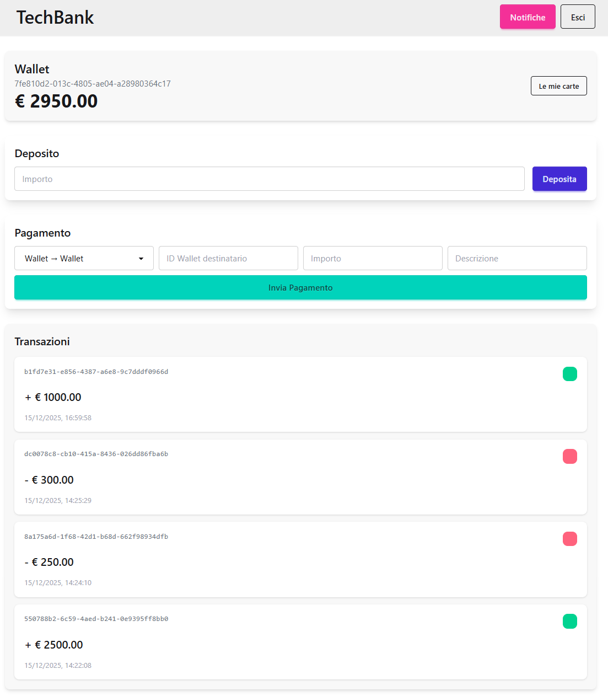
</p>

## Contents

- [Features](#features)
- [Architecture](#architecture)
- [How it works](#how-it-works)
- [Quick start with Docker](#quick-start-with-docker)
- [Local development](#local-development)
- [Configuration](#configuration)
- [API](#api)
- [Frontend](#frontend)
- [Repository structure](#repository-structure)
- [Documentation](#documentation)
- [Notes](#notes)

## Features

**Users**

- Sign-up (adults only) and login.
- A personal wallet, created automatically at sign-up: balance, deposits, transaction history and transaction details.
- Payments from the wallet to another wallet or to a card.
- Multiple virtual cards per user, with a *standard* or *amount limited* policy (a maximum balance allowed on the card).
- Card recharges from the wallet, and payments from a card to another card or to a wallet.
- Card dismissal, with the remaining balance automatically refunded to the wallet.
- Notifications when an asynchronous operation fails, for example because of insufficient funds or a blocked card.

**Administrators**

- List, view, create (including other administrators), edit, ban and delete users.
- View every user's wallet, cards, transactions and notifications.
- Block and unblock wallets and cards.
- An **API Test** page that repeatedly calls the administration endpoints and reports successes, errors and average response time for each of them.

## Architecture

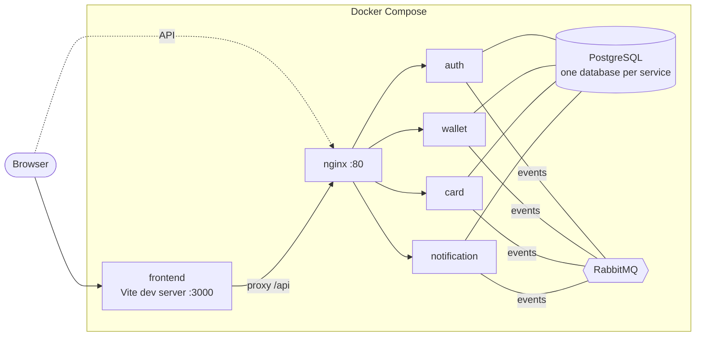

| Service | API prefix | Database | Responsibilities |
|---|---|---|---|
| **auth** | `/api/auth/v1` | `authservicedb` | Users and credentials (bcrypt); issuing, refreshing and revoking JWTs; user administration. It is the only service that holds the private key. |
| **wallet** | `/api/wallet/v1` | `walletservicedb` | One wallet per user: deposits, wallet → wallet and wallet → card payments, and the wallet side of card recharges, refunds and payments coming from cards. |
| **card** | `/api/card/v1` | `cardservicedb` | Virtual cards and their policies: creation, recharge, card → card and card → wallet payments, dismissal. |
| **notification** | `/api/notification/v1` | `notificationservicedb` | Receives the notifications emitted by the other services and makes them available to users. |

- **nginx** is the entry point for the APIs: it routes `/api/<service>/` to the matching container, which listens on port 8000 inside the Docker network.
- **PostgreSQL 15** is a single instance that hosts a separate database for each service. On startup, each service creates its own database if it does not exist, and then its tables with `Base.metadata.create_all`.
- **RabbitMQ 3** carries events between services. Services do not call each other over HTTP, apart from downloading the public key on startup.

### Tech stack

| Layer | Technologies |
|---|---|
| Backend | Python 3.11, FastAPI, Pydantic 2, SQLAlchemy 2 (async) with asyncpg, FastStream for RabbitMQ, python-jose (JWT RS256), passlib + bcrypt, Uvicorn |
| Frontend | React 19, TypeScript, Vite 7, React Router 7, Axios, Tailwind CSS 3 + DaisyUI 5 |
| Infrastructure | PostgreSQL 15, RabbitMQ 3, Nginx, Docker Compose |

## How it works

### User replication across services

Users live in the auth service. Wallet, card and notification keep a minimal replica of them (the `users_ref` table: id, name and surname), fed by the events that the auth service publishes on three **fanout** RabbitMQ exchanges:

| Exchange | Published when | Effect on wallet, card and notification |
|---|---|---|
| `user.created` | a user signs up, or an admin creates a user with the `user` role | creates the local replica of the user; the wallet service also creates the user's wallet with a zero balance |
| `user.deleted` | an admin deletes a user | deletes the local replica and, by cascade, the user's wallet, cards, transactions and notifications |
| `token.revoked` | on logout | adds the token identifier (`jti`) to the local blacklist |

Each service binds its own durable queue to the exchange (for example `wallet-user-created`, `card-user-created`, `notification-user-created`). Administrators are not replicated: they have no wallet, cards or notifications.

### Operations between wallets and cards

Operations that involve a single service are synchronous. Operations that move money between wallets and cards follow a **saga** pattern: the service that receives the request publishes an event, the other service performs its part and replies with an outcome event. If the outcome is negative, the user receives a notification.

| Operation | Endpoint | Execution |
|---|---|---|
| Wallet deposit | `POST /api/wallet/v1/private/deposit` | synchronous |
| Wallet → wallet payment | `POST /api/wallet/v1/private/payment` | synchronous: debit and credit in the same transaction |
| Card → card payment | `POST /api/card/v1/private/payment/{card_id}` | synchronous; also checks the limit of the receiving card |
| Creating a card with an initial amount, recharging a card | `POST /api/card/v1/private/new-card`, `POST /api/card/v1/private/recharge/{card_id}` | asynchronous: the wallet is debited first, then the card is credited |
| Wallet → card payment | `POST /api/wallet/v1/private/payment` | asynchronous: the receiving card is credited first, then the wallet is debited |
| Card → wallet payment | `POST /api/card/v1/private/payment/{card_id}` | asynchronous: the receiving wallet is credited first, then the card is debited |
| Card dismissal | `PATCH /api/card/v1/private/dismiss/{card_id}` | the card is deactivated immediately; the remaining balance goes back to the wallet asynchronously and, if the refund fails, the card is reactivated (compensation) |

Example: recharging a card.

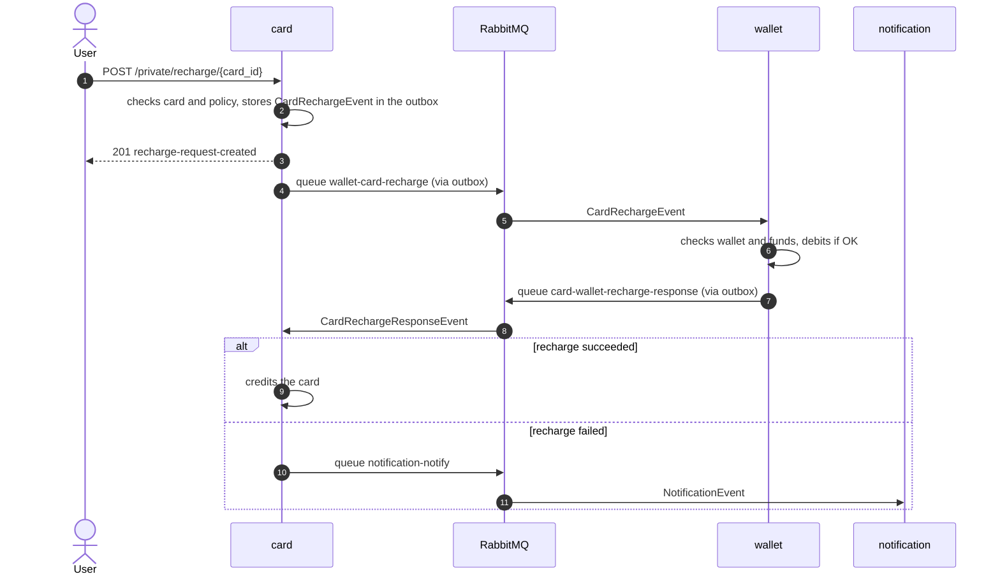

Queues used for requests and responses:

| Queue | From → to | Content |
|---|---|---|
| `wallet-card-recharge` | card → wallet | card recharge request (also sent when a card is created with an initial amount) |
| `card-wallet-recharge-response` | wallet → card | recharge outcome |
| `wallet-card-refund` | card → wallet | refund of a dismissed card's balance |
| `card-wallet-refund-response` | wallet → card | refund outcome |
| `wallet-to-card-payment` | wallet → card | wallet-to-card payment |
| `wallet-to-card-payment-response` | card → wallet | payment outcome |
| `card-to-wallet-payment` | card → wallet | card-to-wallet payment |
| `card-to-wallet-payment-response` | wallet → card | payment outcome |
| `notification-notify` | wallet, card → notification | notification for the user |

All event schemas are defined in `app/v1/common/schemas/events.py`.

> [!TIP]
> Asynchronous operations answer the HTTP request immediately (for example with `recharge-request-created`) and complete a few seconds later: reload the page to see the updated balances.

### Outbox, inbox and concurrency

- **Transactional outbox**: endpoints and consumers never publish to RabbitMQ directly. They write the event to the `outbox_events` table within the same transaction that changes the data, so either both the change and the event are saved or neither is. A background task (`outbox_forwarding_loop`) reads pending events every 3 seconds, in batches of 10 with `SELECT … FOR UPDATE SKIP LOCKED`, publishes them as persistent messages and marks them as `sent` (or `failed`). The loop runs in auth, wallet and card; notification only consumes events.
- **Idempotent inbox**: the consumers of the request and response queues are decorated with `@inbox_based_idempotency`, which records the message's `event_id` in the `inbox_events` table (with a unique constraint) before processing it. A message that has already been seen is skipped; if processing fails, the record is removed so that a redelivery of the same event is not mistaken for a duplicate.
- **Concurrency**: operations that change a balance read wallets and cards with `SELECT … FOR UPDATE`, so concurrent changes to the same balance are serialized.

### Authentication and authorization

- The auth service signs JWTs with the **RS256** algorithm, using the private key in `backend/authservice/app/v1/keys/`. The other services download the public key on startup from `GET /api/auth/v1/public-key` (the `PUBLIC_KEY_ENDPOINT` variable) and verify tokens locally, without calling the auth service on every request.
- The token travels in an HttpOnly cookie named `jwt_token` and contains `sub` (user id), `role`, `jti`, `iat`, `exp` and `refresh_counter`.
- A token lasts 180 seconds. `GET /api/auth/v1/refresh-token` issues a new one only if the current token expired no more than 60 seconds ago, and at most 4 times in a row; after that, a new login is required. The frontend's Axios clients call the refresh endpoint automatically when a request gets a `401`.
- On logout, the token's `jti` is added to the auth service's blacklist and, through the `token.revoked` event, to the local blacklist of every other service.
- `JWTAuthMiddleware` validates the token on every route except the public ones and the docs (`/docs`, `/redoc`, `/openapi.json`). `RuledAPIRouter` then checks the role: `/private` routes are reserved for the `user` role (in the auth service also for `admin`, for `/me` and `/logout`), and `/admin` routes for the `admin` role.
- Banned users can neither log in nor refresh their token.

**Default admin**: on startup, the auth service creates the user `admin@example.com` with password `root1234`, if it does not exist.

## Quick start with Docker

Requirements: Docker with the Compose v2 plugin.

```bash
git clone https://github.com/marinoi/techbank.git
cd techbank
docker compose up --build
```

| What | Address |
|---|---|
| Web app | http://localhost:3000 |
| APIs through nginx | `http://localhost/api/...`, for example http://localhost/api/auth/v1/health-check |

Log in with the default admin (`admin@example.com` / `root1234`) or create a user from the **Registrati** (sign up) page.

- The first start takes a few minutes. The containers start in a cascade (PostgreSQL and RabbitMQ → auth → wallet → card; notification after auth; frontend and nginx after auth and wallet), and each one waits until its dependencies pass their healthcheck, which runs every 60 seconds.
- PostgreSQL, RabbitMQ and the backend services do not expose any port on the host: the APIs are reachable only through nginx.
- PostgreSQL has no named volume: data survives a `docker compose stop` followed by `docker compose start`, but after `docker compose down` the database starts empty.
- The frontend runs on the Vite dev server and mounts its sources from `./frontend`, so changes are hot-reloaded.

To try the APIs from a terminal, save the login cookie and reuse it in the following requests (the token lasts 3 minutes):

```bash
curl -c cookies.txt -H "Content-Type: application/json" \
  -d '{"email": "admin@example.com", "password": "root1234"}' \
  http://localhost/api/auth/v1/login

curl -b cookies.txt http://localhost/api/auth/v1/admin/users
```

## Local development

To work on a service without rebuilding the images, you can run everything directly on your machine.

Requirements: Python 3.11 (the version used in the Docker images), Node.js 20, and PostgreSQL and RabbitMQ reachable on `localhost` (ports 5432 and 5672) with the credentials found in the `backend/*/.env.dev` files. For example, with Docker:

```bash
docker run -d --name techbank-postgres -p 5432:5432 \
  -e POSTGRES_PASSWORD=<DB_ADMIN_PASSWORD from .env.dev> postgres:15
docker run -d --name techbank-rabbitmq -p 5672:5672 -p 15672:15672 rabbitmq:3-management
```

The RabbitMQ management console will be available at http://localhost:15672 (`guest` / `guest`).

Then start the services, **beginning with the auth service**, because the others download its public key on startup:

```bash
cd backend/authservice
python -m venv .venv
source .venv/bin/activate      # Windows: .venv\Scripts\activate
pip install -r requirements.txt
python main.py
```

Repeat the same steps for the other services, each in its own terminal. Run `python main.py` from inside the service folder: the `.env.dev` file and the keys folder are looked up relative to the current directory.

| Service | Folder | Port | Swagger UI |
|---|---|---|---|
| auth | `backend/authservice` | 8000 | http://localhost:8000/docs |
| wallet | `backend/walletservice` | 8001 | http://localhost:8001/docs |
| card | `backend/cardservice` | 8002 | http://localhost:8002/docs |
| notification | `backend/notificationservice` | 8003 | http://localhost:8003/docs |

Finally, the frontend:

```bash
cd frontend
npm install
npm run dev        # http://localhost:3000
```

In `frontend/vite.config.ts`, the `/api` proxy points to `http://nginx:80`, a hostname that only exists inside the Docker Compose network. To use the frontend with services running locally, replace that `proxy` block with the per-service configuration (ports 8000–8003) that is commented out in the same file.

Other available scripts: `npm run build`, `npm run lint`, `npm run preview`.

## Configuration

Configuration is split into two levels.

- **`.env` in the repository root**: Docker Compose reads it to fill in the variables in `docker-compose.yml`, namely the PostgreSQL credentials (`DB_ADMIN_USERNAME`, `DB_ADMIN_PASSWORD`, `ADMIN_DB`) and the RabbitMQ ones (`RABBITMQ_DEFAULT_USER`, `RABBITMQ_DEFAULT_PASS`, `RABBIT_DEFAULT_PORT`), plus `AUTHORIZATION_SERVICE_NAME` and `HTTP_SERVER_PORT`, which are used to build the public key URL.
- **`backend/<service>/.env.dev`**: each service's `main.py` loads it with python-dotenv, both locally and in the container (the file is copied into the image). Variables already set in the environment take precedence, so in Docker the values of `DB_HOST`, `RABBITMQ_BROKER_URL` and `PUBLIC_KEY_ENDPOINT` set by Compose win.

> [!IMPORTANT]
> The PostgreSQL credentials appear at both levels: if you change them in `.env`, update them in the four `.env.dev` files as well.

| Variable (`.env.dev`) | Meaning |
|---|---|
| `DB_DIALECT`, `DB_DRIVER` | SQLAlchemy dialect and driver (`postgresql`, `asyncpg`) |
| `DB_HOST`, `DB_PORT` | PostgreSQL address |
| `DB_ADMIN_USERNAME`, `DB_ADMIN_PASSWORD` | PostgreSQL credentials |
| `ADMIN_DB` | database the service connects to on startup to create its own database, if it does not exist |
| `SERVICE_DB_NAME` | the service's database |
| `RABBITMQ_BROKER_URL` | RabbitMQ AMQP URL |
| `SERVICE_NAME` | service name, used as the sender (`emitter`) of notifications |
| `SERVICE_HOST`, `SERVICE_PORT` | listening address when running locally with `python main.py` |
| `FASTAPI_TITLE` | application title in the OpenAPI documentation |
| `PUBLIC_KEY_ENDPOINT` | wallet, card and notification only: URL from which the public key is downloaded |

### JWT keys

The RSA key pair is in `backend/authservice/app/v1/keys/` (`private.pem`, `public.pem`). To generate a new one:

```bash
cd backend/authservice/app/v1/keys
openssl genrsa -out private.pem 2048
openssl rsa -in private.pem -pubout -out public.pem
```

After changing the keys, restart all services, because the other services download the public key only on startup; with Docker, rebuild the images (`docker compose up --build`). Tokens issued earlier will no longer be valid.

## API

All endpoints live under `/api/<service>/v1` and are split into three groups: public, `/private` (authenticated user) and `/admin` (administrator). Each service exposes `GET /health-check` and the interactive documentation at `/docs`, which is reachable when the services run locally. Application errors have the form `{"detail": "<code>"}`, with codes such as `wallet-not-found`, `no-enough-funds` or `card-limit-future-overflow`; request validation errors use FastAPI's standard `422` format.

<details>
<summary><strong>Auth service</strong>: <code>/api/auth/v1</code></summary>

| Method | Endpoint | Access | Description |
|---|---|---|---|
| `POST` | `/signup` | public | sign-up with the `user` role, adults only |
| `POST` | `/login` | public | login: sets the `jwt_token` cookie and returns name, surname, email and role |
| `GET` | `/refresh-token` | public | renews a token that expired no more than 60 seconds ago |
| `GET` | `/public-key` | public | RSA public key used to verify JWTs |
| `GET` | `/health-check` | public | service status |
| `GET` | `/private/me` | user, admin | current user's data |
| `GET` | `/private/logout` | user, admin | logout and token revocation |
| `GET` | `/admin/users` | admin | list of users |
| `GET` | `/admin/users/{user_id}` | admin | user details |
| `POST` | `/admin/user/new` | admin | creates a user or an administrator |
| `PUT` | `/admin/users/update/{user_id}` | admin | edits email, name, surname and date of birth |
| `PATCH` | `/admin/users/ban/{user_id}` | admin | bans a user |
| `DELETE` | `/admin/users/delete/{user_id}` | admin | deletes a user |

`POST /signup` body:

```json
{
  "email": "jane.doe@example.com",
  "name": "Jane",
  "surname": "Doe",
  "date_of_birth": "1990-05-12",
  "password": "password123"
}
```

</details>

<details>
<summary><strong>Wallet service</strong>: <code>/api/wallet/v1</code></summary>

| Method | Endpoint | Access | Description |
|---|---|---|---|
| `GET` | `/private/wallet` | user | the user's wallet |
| `GET` | `/private/transactions` | user | wallet transactions |
| `GET` | `/private/transactions/{transaction_id}` | user | transaction details |
| `POST` | `/private/deposit` | user | deposit to the wallet, for example `{"amount": "100.00"}` |
| `POST` | `/private/payment` | user | payment to a wallet or a card |
| `GET` | `/admin/wallets` | admin | all wallets |
| `GET` | `/admin/wallet/{user_id}` | admin | a user's wallet |
| `GET` | `/admin/wallets/{wallet_id}` | admin | wallet details, with status and dates |
| `GET` | `/admin/transactions/{wallet_id}` | admin | a wallet's transactions |
| `GET` | `/admin/transactions/{wallet_id}/{transaction_id}` | admin | transaction details |
| `PATCH` | `/admin/block/{wallet_id}` | admin | blocks a wallet |
| `PATCH` | `/admin/unblock/{wallet_id}` | admin | unblocks a wallet |

`POST /private/payment` body (`transaction_type` is either `wallet-to-wallet` or `wallet-to-card`):

```json
{
  "amount": "25.00",
  "counterparty_instrument_id": "<destination wallet or card id>",
  "transaction_type": "wallet-to-wallet",
  "description": "Dinner"
}
```

</details>

<details>
<summary><strong>Card service</strong>: <code>/api/card/v1</code></summary>

| Method | Endpoint | Access | Description |
|---|---|---|---|
| `GET` | `/private/cards` | user | the user's active cards |
| `GET` | `/private/cards/{card_id}` | user | card details, with policy and limit |
| `GET` | `/private/transactions/{card_id}` | user | a card's transactions |
| `GET` | `/private/transactions/{card_id}/{transaction_id}` | user | transaction details |
| `POST` | `/private/new-card` | user | new card, with an optional initial amount taken from the wallet |
| `POST` | `/private/recharge/{card_id}` | user | recharges the card from the wallet, for example `{"amount": "50.00"}` |
| `PATCH` | `/private/dismiss/{card_id}` | user | dismisses the card and refunds its balance to the wallet |
| `POST` | `/private/payment/{card_id}` | user | payment to a card or a wallet |
| `GET` | `/admin/cards` | admin | all cards |
| `GET` | `/admin/card/{user_id}` | admin | a user's cards |
| `GET` | `/admin/cards/{card_id}` | admin | card details |
| `GET` | `/admin/transactions/{card_id}` | admin | a card's transactions |
| `GET` | `/admin/transactions/{card_id}/{transaction_id}` | admin | transaction details |
| `PATCH` | `/admin/block/{card_id}` | admin | blocks a card |
| `PATCH` | `/admin/unblock/{card_id}` | admin | unblocks a card |

`POST /private/new-card` body:

```json
{
  "amount": "100.00",
  "policy": ["card-amount-limited-policy"],
  "amount_limit": "500.00"
}
```

- `policy` is either `card-standard-policy` (the default) or `card-amount-limited-policy`. With the latter, the card balance cannot exceed `amount_limit`: recharges and incoming payments that would exceed it are rejected.
- The body of `POST /private/payment/{card_id}` has the same shape as the wallet one, with `transaction_type` set to `card-to-card` or `card-to-wallet`.

</details>

<details>
<summary><strong>Notification service</strong>: <code>/api/notification/v1</code></summary>

| Method | Endpoint | Access | Description |
|---|---|---|---|
| `GET` | `/private/notifications` | user | the user's notifications, newest first |
| `GET` | `/private/notifications/{notification_id}` | user | notification details |
| `GET` | `/admin/notifications/{user_id}` | admin | a user's notifications |
| `GET` | `/admin/notifications/{user_id}/{notification_id}` | admin | notification details |

Each notification reports the service that generated it (`emitter`), the error code (`reason`, for example `no-enough-funds`), a human-readable message (`message`) and the event that caused it (`source_event_id`).

</details>

## Frontend

The user interface is in Italian.

| Path | Access | Content |
|---|---|---|
| `/` | public | home page |
| `/login`, `/signin` | public | login and sign-up |
| `/wallet` | user | wallet balance, deposits, payments and transactions |
| `/cards` | user | cards: creation, recharge, payments, deletion and transactions |
| `/notification` | user | received notifications |
| `/dashboard` | admin | management of users, wallets, cards and notifications |
| `/stress-test` | admin | API Test page |

- `RoleContext` fetches the current role when the app starts, with `GET /api/auth/v1/private/me`; protected routes redirect to `/login` if the role does not match.
- `src/api/` contains a typed Axios client for each service, with TypeScript models that mirror the backend schemas.

## Repository structure

```text
.
├── backend/
│   ├── authservice/
│   │   ├── app/v1/
│   │   │   ├── common/        # shared code, identical in every service
│   │   │   ├── keys/          # RSA keys used to sign JWTs
│   │   │   ├── models/        # SQLAlchemy models
│   │   │   ├── password/      # bcrypt hashing
│   │   │   ├── routes/        # public, private and admin routers
│   │   │   ├── schemas/       # Pydantic input and output schemas
│   │   │   ├── tests/
│   │   │   └── token/         # JWT creation and configuration
│   │   ├── main.py
│   │   ├── Dockerfile
│   │   ├── requirements.txt
│   │   └── .env.dev
│   ├── walletservice/         # same layout, plus subscribers/ for the RabbitMQ consumers
│   ├── cardservice/           # same layout
│   └── notificationservice/   # same layout
├── frontend/
│   └── src/
│       ├── api/               # Axios clients and models for each service
│       ├── components/
│       ├── contexts/          # RoleContext: current role and protected routes
│       └── pages/
├── nginx/default.conf         # reverse proxy to the services
├── docs/                      # ER diagrams, UML use cases, screenshots
├── docker-compose.yml
└── .env                       # variables for Docker Compose
```

Contents of `app/v1/common/`:

| Folder | Contents |
|---|---|
| `broker/` | RabbitMQ broker (FastStream), shared exchanges and queues |
| `db/` | async engine, base model, the `outbox_events`, `inbox_events` and `tokens_blacklist` tables, database creation |
| `outbox/` | loop that forwards outbox events to RabbitMQ |
| `inbox/` | idempotency decorator for consumers |
| `schemas/` | events and enums exchanged between services |
| `security/` | key loading, JWT validation, middleware and role-checking router |
| `misc/` | cookie configuration, singleton metaclass |

> [!NOTE]
> `common/` is copied into every service and the files are identical: a change must be replicated in all four.

## Documentation

The `docs/` folder contains the ER diagrams of the databases, the UML use case diagrams and screenshots of the application.

<details>
<summary>ER diagrams</summary>

**authservicedb**


**walletservicedb**


**cardservicedb**


**notificationservicedb**


</details>

<details>
<summary>UML use cases</summary>

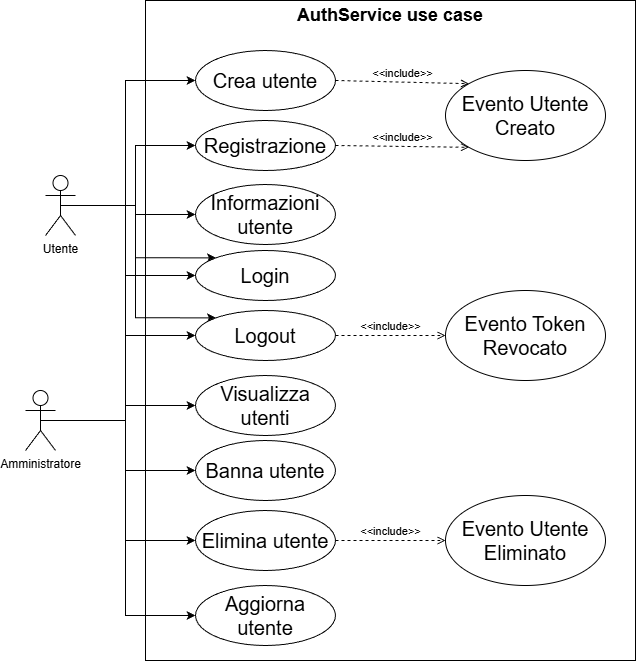

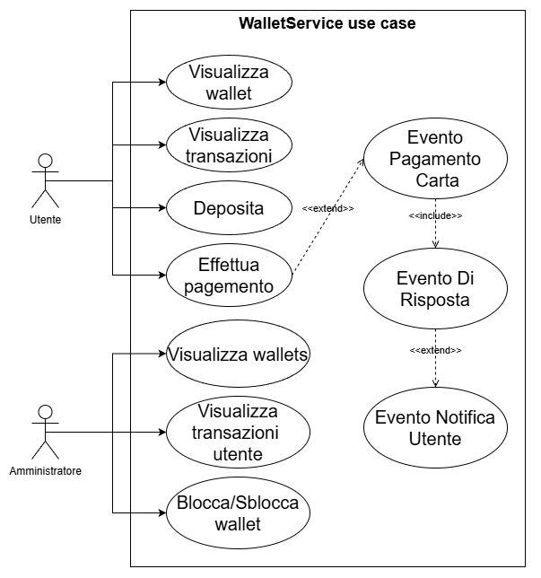

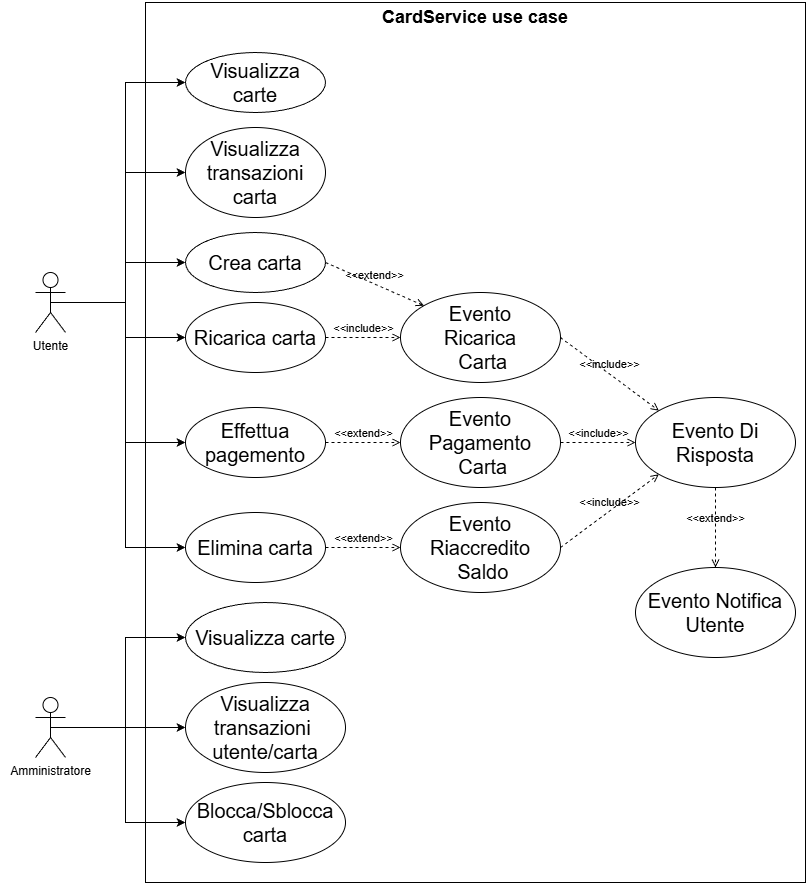

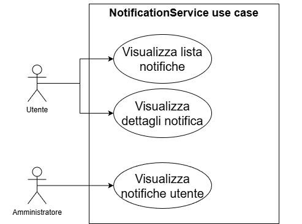

</details>

<details>
<summary>Screenshots</summary>

<table>
  <tr>
    <td align="center">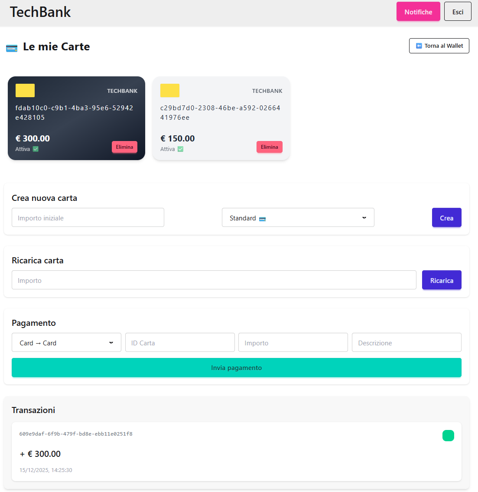<br>User's cards</td>
    <td align="center">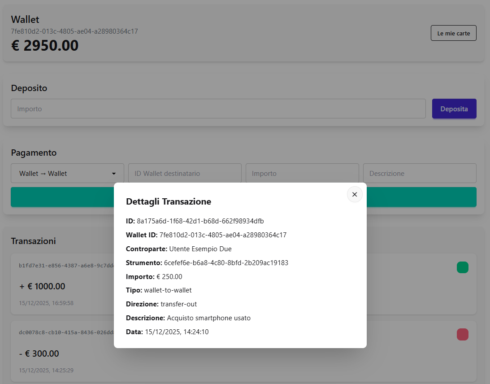<br>Transaction details</td>
  </tr>
  <tr>
    <td align="center">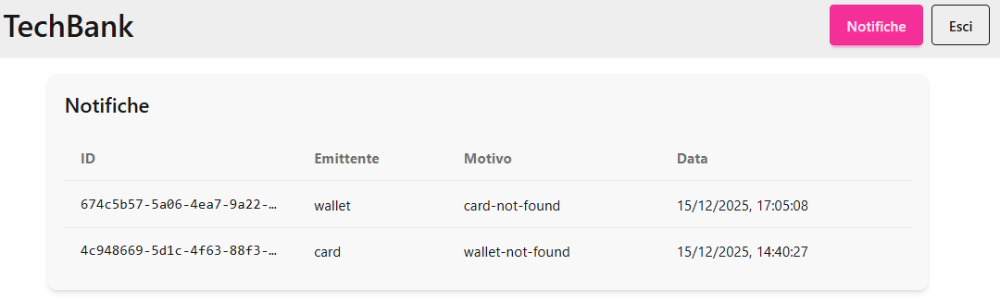<br>Notifications</td>
    <td align="center">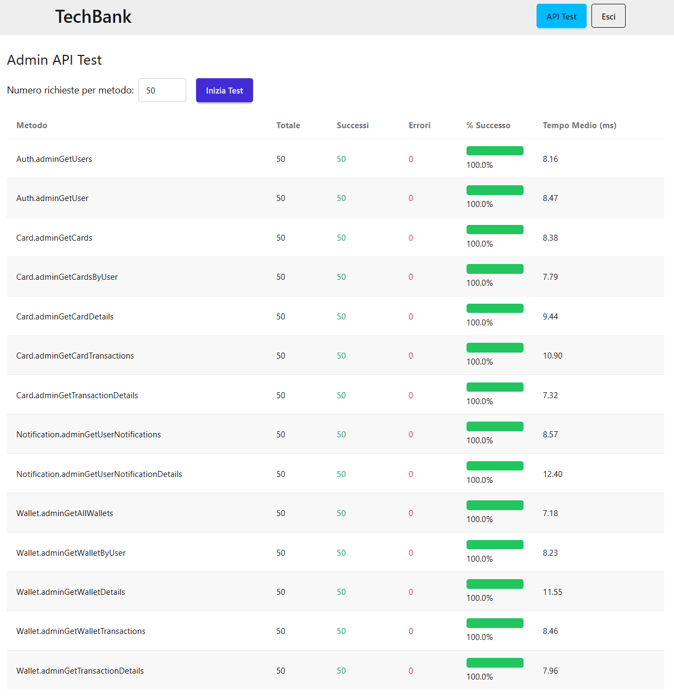<br>API Test (admin)</td>
  </tr>
  <tr>
    <td align="center">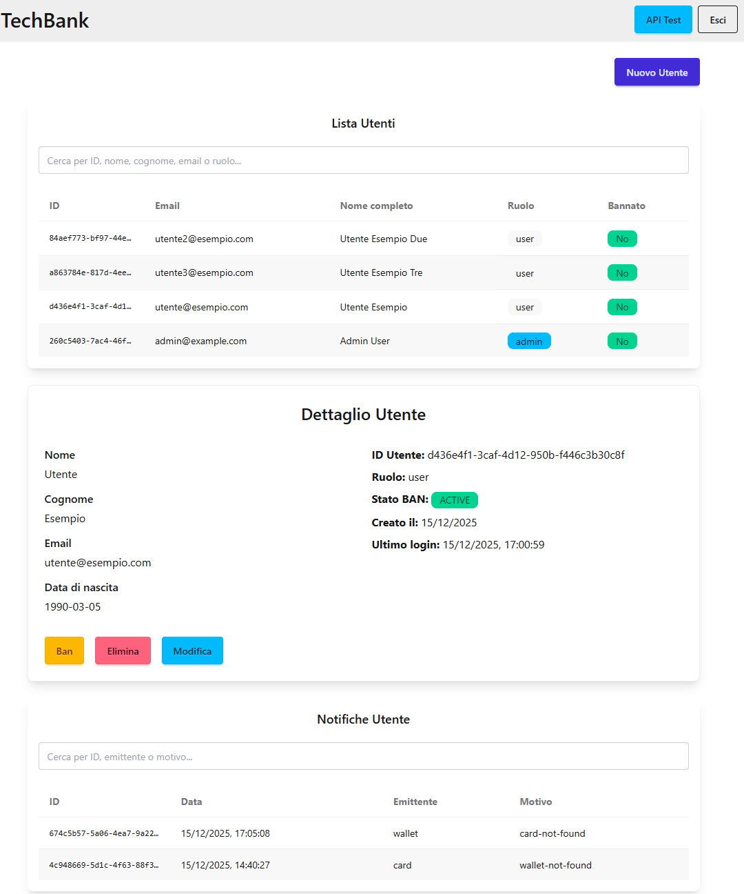<br>Admin dashboard: users and notifications</td>
    <td align="center">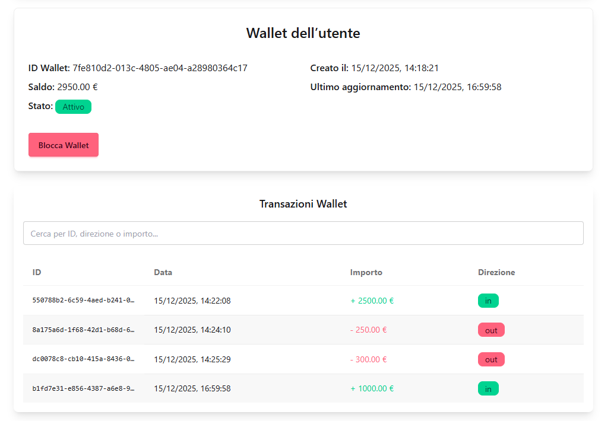<br>Admin dashboard: user's wallet</td>
  </tr>
  <tr>
    <td align="center">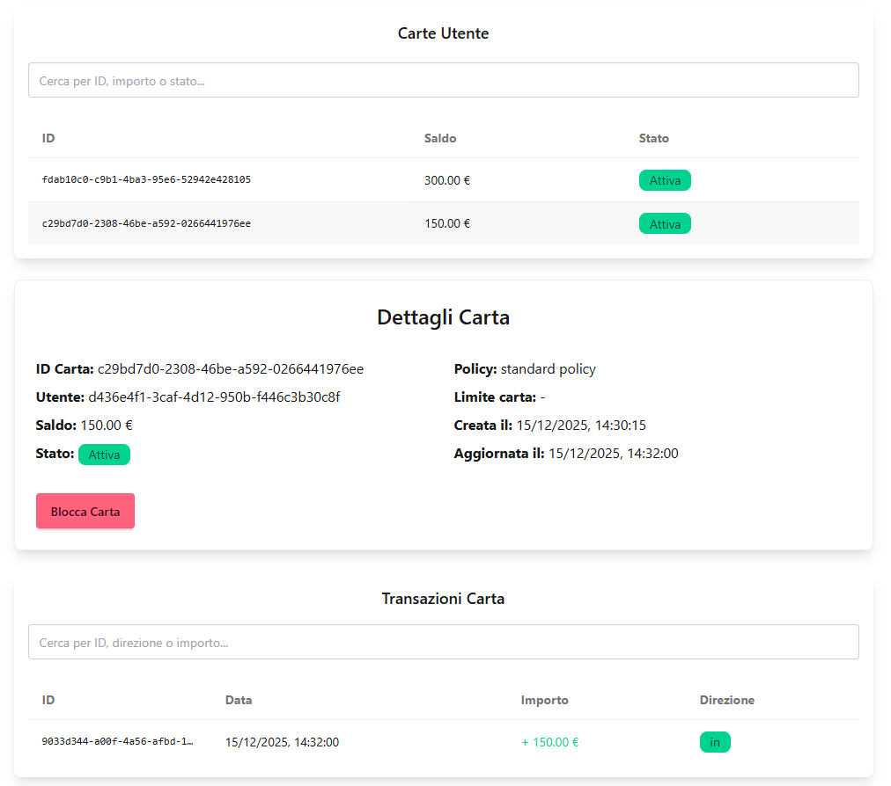<br>Admin dashboard: user's cards</td>
    <td></td>
  </tr>
</table>

Swagger UI of each service: [auth](docs/screenshot/authserviceSwagger.png), [wallet](docs/screenshot/walletserviceSwagger.png), [card](docs/screenshot/cardserviceSwagger.png), [notification](docs/screenshot/notificationserviceSwagger.png).

</details>

## Notes

- The credentials in `.env` and in the `.env.dev` files, the default admin password and the RSA key pair are committed to the repository for development convenience: replace them before any non-local use.
- The configuration targets local use over plain HTTP: the token cookie does not have the `Secure` flag and CORS accepts any origin.
- The database schema is created on startup with `create_all`, without migrations (Alembic is among the dependencies but is not configured).
- The test files in `backend/*/app/v1/tests/` are in place but still empty.
- Deposits are simulated: no real payment network is involved.

## Author

Marino Iannarelli ([@marinoi](https://github.com/marinoi))
